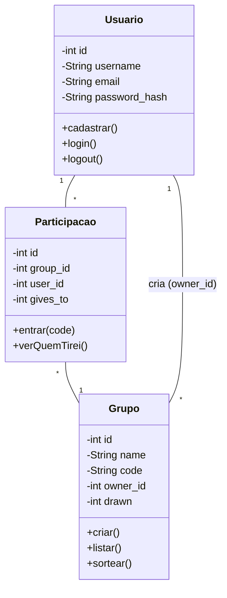

# Documentação: Amigo Secreto Online

Sistema web para organizar amigos secretos. Usuários criam conta, montam grupos, convidam amigos por código e o dono do grupo faz o sorteio. Cada participante vê somente quem tirou.

Projeto didático, pensado para iniciantes em programação.

## 1. Visão geral

### O que o sistema faz

- Cadastro e login de usuários (senha guardada com hash).
- Criação de grupos de amigo secreto, cada um com um código de convite.
- Entrada em grupos pelo código.
- Sorteio feito pelo dono do grupo, sem ninguém tirar a si mesmo.
- Tela individual mostrando "Você tirou: Fulano".

### Tecnologias

| Parte | Tecnologia |
|---|---|
| Runtime e servidor | Bun (`Bun.serve`) |
| Linguagem do servidor | TypeScript |
| Banco de dados | SQLite (`bun:sqlite`), arquivo `database.sqlite` |
| Front end | HTML, CSS e JavaScript puros |
| Senhas | `Bun.password` (hash e verificação) |
| Sessão | Cookie `ses` + objeto em memória |

## 2. Estrutura de pastas

```
amigo-secreto/
├── README.md
├── database.sqlite      (criado automaticamente na primeira execução)
└── src/
    ├── index.ts         servidor e todas as rotas
    ├── db.ts            conexão e criação das tabelas
    ├── index.html       tela de login e cadastro
    ├── home.html        lista de grupos, criar grupo, entrar com código
    └── grupo.html       participantes, sorteio e resultado
```

## 3. Como rodar

1. Instale o Bun (https://bun.sh).
2. Abra o terminal dentro da pasta `amigo-secreto`.
3. Execute:

```
bun src/index.ts
```

4. Acesse `http://localhost:3000`.

O arquivo `database.sqlite` é criado na pasta de onde o comando foi executado. Para zerar os dados, pare o servidor e apague esse arquivo.

## 4. Banco de dados

### Diagrama de relações

```
[users] 1 ----< [members] >---- 1 [groups]
```

Um usuário pode estar em vários grupos e um grupo tem vários usuários. Essa relação "vários para vários" é resolvida pela tabela do meio, `members`: cada linha significa "este usuário participa deste grupo".

### Diagrama de classes



Cada classe é uma tabela do banco (Usuario = `users`, Participacao = `members`, Grupo = `groups`) e os métodos são as ações da API. Um usuário participa de vários grupos e um grupo tem vários usuários, ligados pela Participação. Além disso, um usuário cria vários grupos (campo `owner_id`).

### Tabela `users`

| Coluna | Tipo | Descrição |
|---|---|---|
| id | INTEGER, chave primária | Identificador automático |
| username | TEXT, único | Nome de login |
| email | TEXT, único | E-mail do usuário |
| password_hash | TEXT | Senha após o hash (nunca a senha pura) |

### Tabela `groups`

| Coluna | Tipo | Descrição |
|---|---|---|
| id | INTEGER, chave primária | Identificador automático |
| name | TEXT | Nome do grupo |
| code | TEXT, único | Código de convite (6 caracteres) |
| owner_id | INTEGER | Id do usuário que criou (referência a `users`) |
| drawn | INTEGER | 0 = ainda não sorteou, 1 = já sorteou |

### Tabela `members`

| Coluna | Tipo | Descrição |
|---|---|---|
| id | INTEGER, chave primária | Identificador automático |
| group_id | INTEGER | Grupo (referência a `groups`) |
| user_id | INTEGER | Usuário (referência a `users`) |
| gives_to | INTEGER | Id do usuário que este membro vai presentear. Fica vazio (NULL) até o sorteio |

A combinação (`group_id`, `user_id`) é única: o mesmo usuário não entra duas vezes no mesmo grupo.

## 5. Autenticação e sessão

1. O usuário envia `username` e `password` para `POST /api/login`.
2. O servidor busca o usuário e compara a senha com o hash usando `Bun.password.verify`.
3. Se estiver certo, gera um código aleatório com `crypto.randomUUID()`.
4. Esse código vira a chave do objeto `sessoes` na memória, guardando `{ id, username }`.
5. O mesmo código é enviado ao navegador no cookie `ses`.
6. Em cada requisição protegida, a função `usuarioLogado(req)` lê o cookie e procura o código em `sessoes`. Se não achar, a rota responde 401.

No logout, o código é apagado de `sessoes` e o cookie é removido.

## 6. Referência da API

Todas as rotas de dados começam com `/api`. Corpo de entrada e de saída em JSON. Erros devolvem `{ "msg": "texto do erro" }`.

Rotas marcadas com "login" exigem usuário logado e respondem **401** (`nao logado`) caso contrário.

### Páginas

| Rota | Arquivo | Descrição |
|---|---|---|
| `/` | index.html | Login e cadastro |
| `/home` | home.html | Lista de grupos |
| `/grupo?id=N` | grupo.html | Tela de um grupo |

### Conta

**POST /api/cadastro**

- Entrada: `{ username, email, password }`
- Sucesso (200): `{ ok: true }`
- Erros: 400 `preencha tudo`; 409 `usuario ou email ja existe`

**POST /api/login**

- Entrada: `{ username, password }`
- Sucesso (200): `{ ok: true }` e define o cookie `ses`
- Erros: 404 `usuario nao encontrado`; 401 `senha incorreta`

**POST /api/logout**

- Entrada: nenhuma
- Sucesso (200): `{ ok: true }`

**GET /api/eu** (login)

- Sucesso (200): `{ id, username }`

### Grupos

**GET /api/grupos** (login)

- Lista os grupos em que o usuário participa.
- Sucesso (200): `[ { id, name, code, drawn } ]`

**POST /api/grupos** (login)

- Entrada: `{ name }`
- Cria o grupo, gera o código de convite e já adiciona o criador como membro.
- Sucesso (200): `{ id, code }`
- Erro: 400 `de um nome ao grupo`

**POST /api/grupos/entrar** (login)

- Entrada: `{ code }` (maiúsculas ou minúsculas)
- Sucesso (200): `{ id }`
- Erros: 404 `codigo nao existe`; 400 `esse grupo ja sorteou`; 409 `voce ja esta nesse grupo`

**GET /api/grupos/:id** (login)

- Só quem é membro pode ver.
- Sucesso (200): `{ name, code, drawn, souDono, pessoas: [ { username } ] }`
- Erro: 403 `voce nao esta nesse grupo`
- Importante: esta rota **nunca** devolve o campo `gives_to`.

**POST /api/grupos/:id/sortear** (login)

- Só o dono, uma única vez, com pelo menos 3 participantes.
- Sucesso (200): `{ ok: true }`
- Erros: 404 `grupo nao existe`; 403 `so o dono sorteia`; 400 `ja sorteou`; 400 `precisa de pelo menos 3 pessoas`

**GET /api/grupos/:id/meu** (login)

- Devolve quem o **usuário logado** tirou.
- Sucesso (200): `{ tirou: "nome" }`
- Erro: 404 `ainda nao sorteou`

## 7. O algoritmo do sorteio

O problema: sortear de forma aleatória sem que ninguém tire a si mesmo.

A versão ingênua (sortear e repetir se alguém tirar a si mesmo) pode demorar e falha com poucas pessoas. A solução usada é a **roda de mãos dadas**:

1. **Embaralhar** a lista de participantes (Fisher-Yates), para a ordem ser aleatória.
2. **Fechar um círculo**: cada pessoa presenteia a próxima da lista, e a última presenteia a primeira.

Exemplo: depois de embaralhar, a lista ficou `Caio, Ana, Edu, Bia, Duda`.

| Quem presenteia | Quem recebe |
|---|---|
| Caio | Ana |
| Ana | Edu |
| Edu | Bia |
| Bia | Duda |
| Duda | Caio |

Propriedades:

- Ninguém tira a si mesmo, e sempre funciona com 2 ou mais pessoas (o sistema exige 3 no mínimo).
- Todos dão e recebem exatamente um presente.
- Limitação: o resultado é sempre um único círculo grande. Dois participantes nunca se tiram mutuamente (A tira B e B tira A), o que é bom, mas também significa que nem todas as combinações possíveis de sorteio podem acontecer.

O resultado é gravado na coluna `gives_to` da tabela `members` e o grupo é marcado com `drawn = 1`.

## 8. Front end

### index.html (login e cadastro)

- Dois formulários: `formLogin` e `formCadastro`.
- No login, envia para `/api/login` e, se der certo, redireciona para `/home`.
- No cadastro, envia para `/api/cadastro` e avisa que já pode entrar.
- Mensagens de erro aparecem em `alert`.

### home.html

- Ao abrir, chama `/api/eu`. Se não estiver logado, volta para `/`.
- Mostra o nome do usuário e o botão **sair**.
- Formulário para criar grupo e formulário para entrar com código.
- Lista os grupos; cada item é um link para `/grupo?id=N`.

### grupo.html

- Lê o `id` da URL com `URLSearchParams`.
- Mostra nome, código de convite e participantes.
- O botão **SORTEAR** só aparece para o dono e enquanto não houve sorteio.
- Depois do sorteio, busca `/api/grupos/:id/meu` e mostra "Você tirou: ...".

### Estilo

O CSS está em uma tag `<style>` no início de cada HTML (igual nos três). Usa apenas seletores de tag: coluna centralizada de 420px, formulários em cartões brancos e botões azuis.

## 9. Regras de segurança implementadas

- Senhas guardadas apenas como hash.
- Consultas ao banco usam parâmetros (`?`), o que evita SQL injection.
- O servidor valida tudo: esconder um botão no front end não protege nada. Exemplos: só o dono sorteia, só membros veem o grupo, só o próprio usuário vê quem tirou.
- O resultado do sorteio dos outros nunca é enviado ao navegador.
- Não se entra em grupo depois do sorteio.

## 10. Limitações conhecidas

Pontos que servem como exercícios de melhoria:

- **Sessões em memória:** ao reiniciar o servidor, todos são deslogados.
- **Sem expiração de sessão.**
- **Cookie sem opções de segurança** definidas além do caminho (`httpOnly`, `sameSite` e `secure` não foram configurados explicitamente).
- **Sem limite de tentativas de login.**
- **Sem validação de senha** (tamanho mínimo) nem de formato de e-mail.
- **Sorteio sem transação:** os `UPDATE` são feitos um a um; uma falha no meio deixaria o sorteio incompleto.
- **Sem exclusões:** casais ou pessoas que não podem se tirar não são tratados.
- **Sem testes automatizados.** O código foi escrito para estudo e deve ser testado manualmente antes de uso real.
- **Erros mostrados com `alert`**, sem mensagens na própria página.

# Prog1-Tri3-Ativ1

## 11. Problemas comuns

| Sintoma | Causa provável | O que fazer |
|---|---|---|
| `Cannot find module` ao iniciar | Rodou o comando na pasta errada | Rodar `bun src/index.ts` de dentro de `amigo-secreto` |
| Porta 3000 em uso | Outro programa usando a porta | Fechar o outro programa ou mudar `port` em `index.ts` |
| Voltou para a tela de login sozinho | Servidor foi reiniciado e a sessão se perdeu | Fazer login de novo |
| "usuario ou email ja existe" | Dados já cadastrados | Usar outro nome ou e-mail, ou apagar `database.sqlite` |
| Botão sortear não aparece | Você não é o dono, ou já sorteou | Conferir com o usuário que criou o grupo |
| "precisa de pelo menos 3 pessoas" | Poucos participantes | Convidar mais gente pelo código |

## 12. Como testar manualmente

1. Abra 3 navegadores ou abas anônimas e cadastre 3 usuários.
2. No primeiro, crie um grupo e copie o código.
3. Nos outros dois, entre com o código.
4. No primeiro (dono), clique em **SORTEAR**.
5. Em cada conta, abra o grupo e confira o "Você tirou". Ninguém pode ter tirado a si mesmo, e os três nomes devem formar um círculo.
6. Tente acessar `/api/grupos/1/meu` com outra conta e confira que só aparece o resultado dela.

## 13. Ideias de evolução

- Lista de desejos por participante, visível apenas para quem o tirou.
- Valor sugerido do presente e data da revelação.
- Regras de exclusão (casais).
- Sessões salvas no SQLite com data de validade.
- Mensagens de erro na tela em vez de `alert`.
- Link de convite em vez de código digitado.

## 14. Glossário

- **Rota:** endereço do servidor que responde a um tipo de pedido (por exemplo, `POST /api/login`).
- **Hash:** transformação de mão única da senha; não dá para recuperar a senha original.
- **Sessão:** forma de o servidor lembrar quem está logado entre uma requisição e outra.
- **Cookie:** pequeno dado guardado no navegador e enviado a cada requisição.
- **Tabela do meio:** tabela que liga duas outras em uma relação "vários para vários".
- **Chave primária:** coluna que identifica cada linha de forma única.
- **Status HTTP:** número da resposta (200 deu certo, 401 não logado, 403 sem permissão, 404 não achou, 409 conflito).
